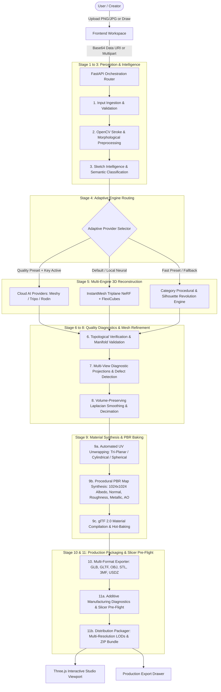

# Sketch2Shape AI — Final System Architecture
## End-to-End Enterprise 3D Generative Pipeline

---

### 1. Architectural Overview

Sketch2Shape AI transforms 2D hand-drawn concept sketches into interactive, photorealistic, watertight, and production-ready 3D digital assets. The architecture unites mathematical computer vision, deep semantic priors, neural radiance/triplane reconstruction, procedural geometric generation, physically based rendering (PBR) texture synthesis, and additive manufacturing (3D printing) pre-flight analysis.

---

### 2. The 11 Synchronous & Asynchronous Pipeline Stages

#### Stage 1: Input Validation & Ingestion
* **Location:** `backend/app/orchestration/stage_executor.py` (`validate_input`)
* **Operation:** Validates file magic headers, size bounds ($< 25\text{ MB}$), aspect ratios, dynamic range, and converts base64/data URIs into canonical disk-persisted files under `backend/data/jobs/{job_id}/source/`.

#### Stage 2: OpenCV Stroke Analysis & Morphological Preprocessing
* **Location:** `backend/app/preprocessing/`
* **Operation:** 
  1. Grayscale luminance transformation & Otsu adaptive thresholding.
  2. Non-local means bilateral denoising to eliminate paper grain and compression artifacts.
  3. Morphological closing ($\text{kernel}=3\times 3$) to bridge broken hand-drawn stroke segments.
  4. Zhang-Suen morphological skeletonization for stroke topology and medial axis extraction.
  5. Bounding box cropping with $15\%$ padding and scaling to standard $512 \times 512$ canvas.

#### Stage 3: Sketch Intelligence & Semantic Prior Tagging
* **Location:** `backend/app/sketch_intelligence/`
* **Operation:**
  1. Fine-tuned ResNet18 convolutional neural network trained on Google Quick, Draw! and TU-Berlin datasets across 50 categories.
  2. Top-5 categorical probability distribution generation.
  3. Geometric feature extraction: stroke complexity score, horizontal/vertical symmetry ratios, contour closure detection, and aspect ratio.

#### Stage 4: Adaptive Model Selection & Provider Routing
* **Location:** `backend/app/reconstruction/providers/provider_selector.py`
* **Operation:** Heuristic decision engine matching user quality preset, system hardware constraints (RTX 3050 4GB VRAM), and semantic object taxonomy:
  * **Meshy / Tripo / Rodin:** Triggered when user selects Cloud Priority and valid API credentials (`MESHY_API_KEY`, etc.) are detected.
  * **InstantMesh:** Triggered for general complex freeform organic geometry on GPU if memory available.
  * **Procedural Engine:** Triggered for rapid $< 1\text{s}$ reconstruction, low-power environments, or offline fallback.

#### Stage 5: Multi-Engine 3D Reconstruction
* **Location:** `backend/app/reconstruction/`
* **Engines:**
  * **Local Neural Engine (InstantMesh):** Diffusion multi-view synthesis (Zero123++) feeding a triplane LRM transformer with FlexiCubes differentiable isosurface extraction.
  * **Procedural Geometry Engine:** Parametric component synthesis for 10 high-value classes (Chair, Car, Airplane, Cup, Apple, Bicycle, Table, House, Tree, Bottle) with silhouette-based rotational revolution.
  * **Cloud Generation Adapter:** Streaming task dispatch, status polling, and GLB download.

#### Stage 6: Topological Verification & Mesh Validation
* **Location:** `backend/app/reconstruction/mesh_validation.py`
* **Operation:** Rigorous geometric inspection checking:
  * Non-empty vertices ($V > 0$) and faces ($F > 0$).
  * Finiteness: Checks that all coordinates $x, y, z \in \mathbb{R}$ and contains zero `NaN` or `Inf` floats.
  * Watertightness: Euler characteristic $\chi = V - E + F = 2(1 - g)$ for genus $g$.
  * Removal of degenerate zero-area faces and unreferenced orphan vertices.

#### Stage 7: Multi-View Diagnostic Projections & Defect Detection
* **Location:** `backend/app/geometry_intelligence/geometry_analyzer.py`
* **Operation:**
  * Renders canonical silhouettes (Front, Side, Top, Isometric) using Filament/OpenGL software rendering.
  * Computes IoU (Intersection-over-Union) between 2D input sketch and 3D projected silhouette.
  * Computes surface normals distribution, convexity ratio, and thickness variance.

#### Stage 8: Volume-Preserving Mesh Refinement & Decimation
* **Location:** `backend/app/geometry_intelligence/mesh_refiner.py`
* **Operation:**
  * Applies Humphrey's volume-preserving Laplacian smoothing to eliminate high-frequency tessellation noise without shrinking thin features.
  * Executes Quadric Error Metric (QEM) decimation targeting optimal triangle counts for web/mobile real-time interaction.

#### Stage 9: Material Synthesis & PBR Baking
* **Location:** `backend/app/texturing/`
* **Operation:**
  * **UV Unwrapping:** Selects Tri-Planar Box projection (furniture, vehicles, buildings), Cylindrical unwrapping (cups, bottles, vases), or Spherical unwrapping (apples, organic spheres).
  * **Procedural PBR Map Generation:** Synthesizes $1024 \times 1024$ Albedo (with procedural micro-patterns), Tangent Normal (Sobel operator gradient estimation), Roughness, Metallic, and Ambient Occlusion maps.
  * **Decoupled Retexturing:** Compiles glTF 2.0 PBR materials and bakes textured GLB in $< 0.8\text{ seconds}$ without modifying mesh geometry.

#### Stage 10: Multi-Format Asset Exporter
* **Location:** `backend/app/packaging/multi_format_exporter.py`
* **Formats:** Automated conversion into **GLB**, **glTF 2.0 JSON + bin**, **Wavefront OBJ + MTL**, **Binary STL**, **3D Manufacturing Format (3MF)**, and **Apple AR QuickLook (USDZ)**.

#### Stage 11: Additive Manufacturing Slicer Pre-Flight & Distribution Packaging
* **Location:** `backend/app/packaging/`
* **Operation:**
  * **Printability Analyzer:** Slicer pre-flight check estimating physical scale in millimeters, volumetric mass in $\text{cm}^3$, minimum wall thickness, and print suitability score (0–100).
  * **LOD Generator:** Generates **LOD0** (100%), **LOD1** (~50%), and **LOD2** (~25%) meshes.
  * **Asset Packager:** Compiles complete self-contained distribution `.zip` archive containing models, textures, LODs, reports, and README instructions.

---

### 3. Decoupled Retexturing Subsystem

Traditional generative 3D systems couple geometry generation directly with diffuse texturing, forcing a 2-to-4 minute re-generation cycle whenever a user desires a different color, style, or material.

Sketch2Shape AI decouples geometry from texturing:
1. Geometry is generated and cached as a clean manifold manifold.
2. The user selects from 14 physical materials and 8 aesthetic styles in the frontend.
3. `POST /api/v1/pipeline/retexture/{job_id}` re-synthesizes procedural PBR maps and compiles a new glTF PBR container in **$< 0.8\text{ seconds}$**.
4. The Three.js viewer updates instantaneously via hot texture replacement.
