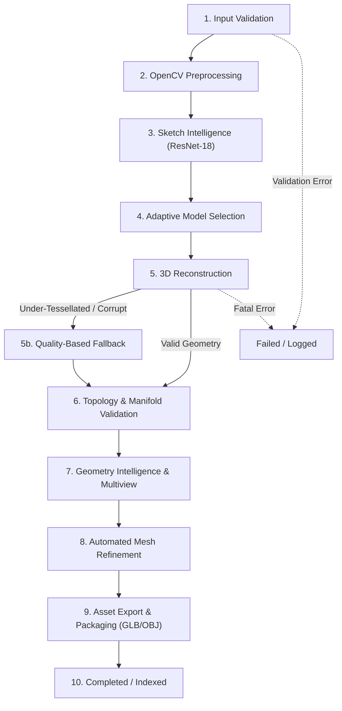

# Sketch2Shape AI — Production Pipeline Orchestration Architecture

**Author:** Autonomous Lead AI/ML Systems Engineer  
**Stage:** Stage 10 of 12 — Production Integration & Adaptive Model Selection  
**Target Architecture:** Windows 11 | NVIDIA GeForce RTX 3050 (4GB VRAM) | FastAPI | React 19  

---

## 1. Executive Summary

Stage 10 integrates all preceding stages (1–9) into a single, cohesive, production-grade sketch-to-3D pipeline. Prior to this integration, subsystems operated as isolated endpoints with potential discrepancies in schemas, unhandled under-tessellation failures, and memory contention risks on 4GB VRAM consumer GPUs.

The **Production Pipeline Orchestrator** introduces:
1. **Unified 11-Stage Lifecycle:** Explicitly tracks input validation, preprocessing, classification, adaptive routing, reconstruction, topology validation, geometry analysis, refinement, and asset packaging.
2. **Deterministic Quality-Based Fallback:** Automatically catches neural reconstruction failures (e.g., severe under-tessellation < 16 vertices) and transparently recovers via category-aware parametric templates.
3. **Hardware-Guaranteed Execution:** A single-worker async queue ensures that GPU diffusion and triplane decoding never run concurrently, strictly enforcing the 3.8 GB VRAM ceiling.
4. **Non-Blocking REST API:** Provides asynchronous job submission, real-time stage progress polling, and cancellation flags.

---

## 2. 11-Stage Pipeline Lifecycle



### Stage Breakdown

| Stage Index | Stage Identifier | Core Operation | Failure Modes & Recovery |
| :--- | :--- | :--- | :--- |
| **01** | `VALIDATING_INPUT` | Decodes base64 PNG/JPEG or validates physical path; verifies image readability. | Non-recoverable; returns HTTP 400 with diagnostic message. |
| **02** | `OPENCV_PREPROCESSING` | Multi-pass bilateral denoising, Otsu/adaptive thresholding, morphological thinning, and 512x512 centering. | Fallback to raw canvas with warning in telemetry. |
| **03** | `SKETCH_INTELLIGENCE` | ResNet-18 inference over 50 QuickDraw / TU-Berlin classes; extracts geometric tags and confidence. | Default category assignment (`chair`, conf=0.5) if low confidence. |
| **04** | `MODEL_SELECTION` | Evaluates category support, user preset, and confidence to select `instantmesh` or `procedural`. | Tiered fallback to category template or generalized engine. |
| **05** | `RECONSTRUCTING_3D` | Executes Zero123++ diffusion + FlexiCubes LRM, or category procedural template. | Quality fallback triggers if verts < 16 or faces < 24. |
| **06** | `MESH_VALIDATION` | Verifies vertex finiteness, manifold edges, and boundary loops via Trimesh. | Automatic repair (welding close vertices, fixing face normals). |
| **07** | `GEOMETRY_ANALYSIS` | Computes bounding box aspect ratios, Euler characteristic, and multi-view silhouettes. | Returns fallback score if rendering context unavailable. |
| **08** | `MESH_REFINEMENT` | Applies Taubin volume-preserving smoothing and Open3D quadric decimation. | Skips refinement if decimation causes non-manifold topology. |
| **09** | `EXPORTING_ASSETS` | Generates verified GLB (binary glTF) and OBJ + MTL files in job artifact directory. | Generates atomic file paths and static URL routes. |
| **10** | `COMPLETED` | Updates job state, records final peak VRAM and execution latency, indexes assets. | Terminal success state. |

---

## 3. Concurrency & Hardware Telemetry (RTX 3050 4GB Safety)

### 3.1 Single-Worker Concurrency Architecture
On a 4GB VRAM GPU, executing two concurrent diffusion jobs causes instantaneous CUDA Out-Of-Memory (OOM) crashes:
$$\text{VRAM}_{\text{Zero123++}} \approx 2.4\,\text{GB} \quad + \quad \text{VRAM}_{\text{LRM}} \approx 1.2\,\text{GB} = 3.6\,\text{GB}$$
Running even two concurrent passes exceeds the 4.0 GB physical boundary.

To eliminate race conditions and OOM crashes:
- `JobManager` utilizes a dedicated `ThreadPoolExecutor(max_workers=1)`.
- All incoming requests are immediately assigned a typed `job_id`, queued in memory, and returned to the client as HTTP 200 with `status="queued"`.
- Real-time client polling (`/api/v1/pipeline/status/{job_id}`) provides non-blocking UX.

### 3.2 Inter-Stage VRAM Management Protocol
At every stage boundary:
1. `torch.cuda.empty_cache()` flushes CUDA allocation blocks.
2. `gc.collect()` clears unreferenced Python tensors.
3. `ExecutionLogger.get_hardware_telemetry()` records `vram_used_mb`, `vram_reserved_mb`, and `ram_used_mb`.

---

## 4. REST API Schema Specification

### 4.1 `POST /api/v1/pipeline/generate`
```json
{
  "image_b64": "data:image/png;base64,...",
  "preferred_model": "auto",
  "quality_preset": "balanced",
  "preprocess_first": true,
  "auto_refine": true,
  "refine_preset": "balanced",
  "export_formats": ["glb", "obj"],
  "allow_fallback": true,
  "category_override": null,
  "async_execution": true
}
```

**Response (HTTP 200):**
```json
{
  "status": "queued",
  "job_id": "job_3a8f19c284e1",
  "created_at": 1730384500.12,
  "current_stage": "initialized",
  "status_url": "/api/v1/pipeline/status/job_3a8f19c284e1",
  "result_url": "/api/v1/pipeline/result/job_3a8f19c284e1",
  "cancel_url": "/api/v1/pipeline/cancel/job_3a8f19c284e1"
}
```

### 4.2 `GET /api/v1/pipeline/status/{job_id}`
```json
{
  "job_id": "job_3a8f19c284e1",
  "status": "processing",
  "current_stage": "reconstructing_3d",
  "stage_history": [
    {
      "stage": "validating_input",
      "duration_seconds": 0.012,
      "success": true,
      "message": "Input valid: input_sketch.png"
    },
    {
      "stage": "opencv_preprocessing",
      "duration_seconds": 0.084,
      "success": true,
      "message": "OpenCV preprocessing completed"
    }
  ],
  "peak_vram_mb": 2420.5,
  "is_cancelled": false
}
```
