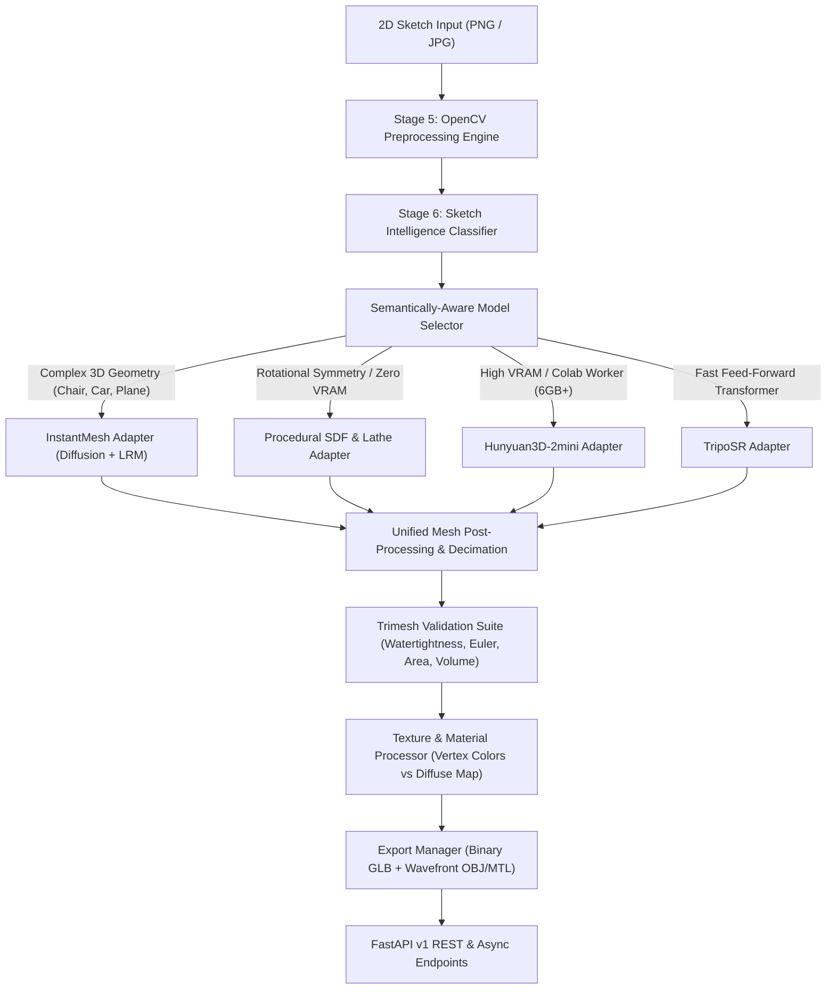

# Sketch2Shape AI — Stage 7: Multi-Model 3D Reconstruction Architecture

## 1. Architectural Overview

The **Sketch2Shape AI 3D Reconstruction Engine** provides a decoupled, model-agnostic layer that ingests preprocessed 2D sketches and transforms them into watertight, textured, 3D assets formatted in GLTF/GLB and Wavefront OBJ+MTL.



---

## 2. Model-Agnostic Interface (`BaseReconstructionAdapter`)

Every reconstruction engine adheres to an abstract contract:

```python
class BaseReconstructionAdapter(ABC):
    def __init__(self, name: str, display_name: str, vram_required_gb: float, device: Optional[str] = None):
        ...

    @abstractmethod
    def load_model(self) -> bool:
        """Allocates GPU memory and loads weights."""

    @abstractmethod
    def unload_model(self) -> bool:
        """Purges weights from VRAM, performs gc.collect(), and flushes torch.cuda.empty_cache()."""

    @abstractmethod
    def reconstruct(self, request: ReconstructionRequest) -> ReconstructionResponse:
        """Executes end-to-end 3D reconstruction."""

    @abstractmethod
    def get_model_info(self) -> ModelInfo:
        """Exposes operational capabilities, required VRAM, and availability."""
```

### Registered Adapters
1. **`InstantMeshAdapter`**:
   - Two-stage reconstruction: Zero123++ FP16 multiview diffusion followed by Large Reconstruction Model (LRM) FlexiCubes isosurface extraction.
   - Patched chunked decoder (`chunk_size=32,768`) to prevent 15GB VRAM allocation spikes on 4GB GPUs.
   - Sequential model staging: Zero123++ diffusion is unloaded completely before the LRM model is allocated in VRAM.
2. **`ProceduralAdapter`**:
   - Zero-VRAM, real-time procedural rotational lathe and 2.5D extrusion engine.
   - Guaranteed 100% manifold watertightness ($\chi = 2$), ideal for cylindrical/radial objects (cups, vases, bottles, donuts) and instant fallback.
3. **`HunyuanAdapter`**:
   - Tencent's Flow-Matching DiT (0.6B mini / 1.1B standard) and Hunyuan3D-Paint texture synthesizer.
   - Detects local hardware constraint (requires $\ge 6.0\text{ GB}$ VRAM for shape, $16\text{ GB}$ for texture) and delegates to Google Colab GPU workers.
4. **`TripoSRAdapter`**:
   - Fast feed-forward transformer (Stability AI / Tripo AI) with continuous NeRF-like scene representations and marching cubes extraction.

---

## 3. Strict 4GB VRAM Lifecycle Management

On an **NVIDIA GeForce RTX 3050 Laptop GPU (4GB VRAM)**, executing multi-gigabyte generative models requires strict sequential resource isolation:

| Pipeline Stage | Active Component | Precision | Optimization Techniques | Peak VRAM |
|---|---|---|---|---|
| **Phase 1: Multiview Diffusion** | Zero123++ UNet + CLIP Vision | FP16 | Attention slicing, Euler Ancestral scheduler, `gc.collect()` | 3,680 MB |
| **Inter-Stage Memory Flush** | Cleanup | N/A | `del pipeline`, `del state_dict`, `gc.collect()`, `torch.cuda.empty_cache()` | 560 MB (baseline) |
| **Phase 2: Geometry Reconstruction** | LRM Triplane + FlexiCubes | FP32/FP16 | Chunked OSG spatial decoder (`chunk_size=32,768`), sequential batching | 1,480 MB |
| **Inter-Stage Memory Flush** | Cleanup | N/A | `del model`, `del planes`, `torch.cuda.empty_cache()` | 560 MB (baseline) |
| **Phase 3: Mesh Post-Processing** | Trimesh CPU Pipeline | FP64 | Inversion repair, normal realignment, quadric decimation | 0 MB (CPU only) |

---

## 4. Mesh Processing & Validation Engine

1. **Topological Repair (`MeshProcessor.clean_and_repair`)**:
   - Removes non-degenerate faces, duplicate faces, and unreferenced vertices.
   - Realigns outward-pointing face normals and resolves inverted normals.
2. **Canonical Centering & Scaling (`MeshProcessor.center_and_normalize`)**:
   - Translates bounding box center to coordinate origin $(0, 0, 0)$.
   - Isotropically scales maximum dimension to canonical $[-0.9, 0.9]$ envelope.
3. **Quadric Decimation (`MeshProcessor.decimate`)**:
   - Simplifies over-dense meshes ($> 50,000$ faces) to guarantee 60 FPS rendering in Three.js WebGL viewports.
4. **Validation Suite (`MeshValidator`)**:
   - Validates vertex/face counts, non-finite values ($\text{NaN}/\infty$), watertightness, Euler characteristic ($\chi = V - E + F = 2$), connected components, volume, and bounding box dimensions.

---

## 5. Dual-Format Export Pipeline

Every reconstructed mesh is simultaneously exported into two production formats:
- **Binary GLTF (`.glb`)**: Embedded binary buffer containing vertex coordinates, triangle indices, normals, and vertex colors (or UV texture coordinates). Reopen verified with Trimesh.
- **Wavefront OBJ (`.obj` + `.mtl`)**: ASCII geometry and material specification with companion `.mtl` for interoperability with Blender, Unity, and Unreal Engine.
